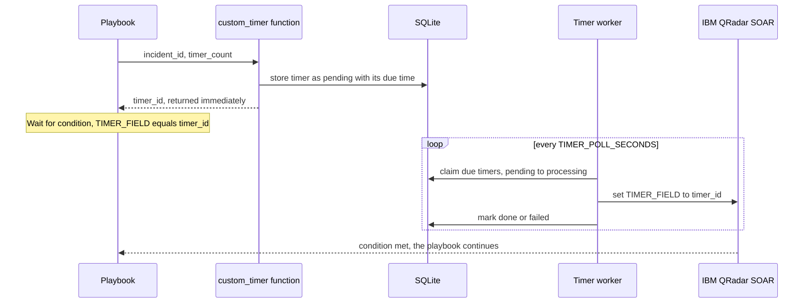

# SOAR Custom Timer

[](https://github.com/AtakanUk/soar-custom-timer/actions/workflows/ci.yml)

[](LICENSE)

Non-blocking timers for IBM QRadar SOAR playbooks.

Playbooks often need to wait: give the customer 4 hours to answer before escalating, re-check a host in 30 minutes, close an incident automatically after a quiet period. A function that simply sleeps occupies one of the few resilient-circuits worker threads for the whole wait. Ten waiting playbooks can then block every other integration. This project moves the waiting out of the function:

1. The playbook calls the `custom_timer` function with `incident_id` and `timer_count` (seconds). The function stores the timer in SQLite and returns immediately with a `timer_id`.
2. A separate worker process polls for due timers and writes the `timer_id` into an incident field (`TIMER_FIELD`).
3. The playbook continues with a native **Wait for condition** step: *field equals the returned timer_id*. Using the ID rather than a fixed value keeps several timers on the same incident apart.



## Reliability

- **Claiming**: a due timer is claimed with an atomic `pending → processing` update, so two workers never fire the same timer.
- **Crash recovery**: on start-up the worker re-queues timers that a previous worker left in `processing`.
- **Conflict-safe update**: the incident field is written with `get_put`, which re-reads and retries when a playbook changed the incident at the same moment (HTTP 409).
- **Failures**: a failed timer (for example, the incident was deleted) is marked `failed` with the error text, and an alert mail is sent. The mail is optional and uses Microsoft 365 SMTP with OAuth2.
- **Limits**: requests above `TIMER_MAX_WAIT_SECONDS` (default 35 days) are rejected. Negative or non-numeric values are rejected too.
- **Logs**: daily rotated logs, 30 days kept. Supervisor configuration is in `deploy/`.

## Layout

```text
soar_custom_timer/
├── function_component.py   # SOAR app function "custom_timer"
├── worker.py               # background worker (python -m soar_custom_timer.worker)
└── notifications.py        # optional alert mail (SMTP XOAUTH2)
deploy/custom_timer_worker.supervisord.conf.sample
```

## Configuration

Both the function and the worker read the environment (the function also accepts `db_path` / `max_wait_seconds` in its app.config section). See `.env.example`.

| Variable | Description |
| --- | --- |
| `TIMER_DB_PATH` | SQLite file shared by the function and the worker |
| `TIMER_MAX_WAIT_SECONDS` | Longest accepted timer |
| `TIMER_POLL_SECONDS`, `TIMER_BATCH_SIZE` | Worker polling |
| `TIMER_FIELD` | Incident text field that receives the timer ID |
| `SOAR_HOST`, `SOAR_PORT`, `SOAR_ORG`, `SOAR_API_KEY_ID`, `SOAR_API_KEY_SECRET`, `SOAR_VERIFY_TLS` | Worker connection to SOAR |
| `ALERT_EMAIL_TO`, `SMTP_*` | Optional alert mail |

## Deployment

1. Add the function to an app package generated with `resilient-sdk codegen` (function `custom_timer`, inputs `incident_id` and `timer_count`), using `function_component.py` as the component.
2. Create the text field `TIMER_FIELD` on incidents.
3. Run the worker under Supervisor or systemd on the integration server, with access to the same `TIMER_DB_PATH`.

## Tests

```bash
pip install -r requirements.txt pytest
pytest
```

The tests use an in-memory database and a fake SOAR client. They cover firing only due timers, the incident update, failure handling with alerting, claiming and crash recovery, and timer storage by the function.

## License

[MIT](LICENSE)
